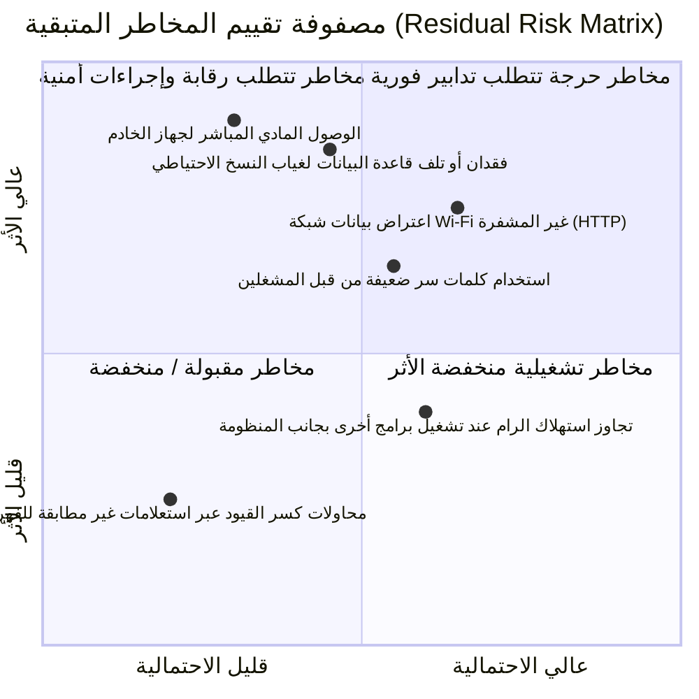

# AMN-EYE — قائمة التحقق الأمني ومصفوفة المخاطر (Security Checklist & Risk Matrix)

> **وثيقة أمنية رسمية:** توثيق التدابير الأمنية المطبقة، معالجة الثغرات السابقة، ومصفوفة المخاطر المتبقية لنظام AMN-EYE بعد ترقية الذكاء الاصطناعي والبحث دون اتصال بالإنترنت.
> **تاريخ التحديث:** أكتوبر 2026
> **البيئة المستهدفة:** جهاز رئيسي (Electron + Express + SQLite + llama.cpp sidecar) وشبكة محلية معزولة (LAN / Wi-Fi).

---

## 1. ملخص التدابير الأمنية المطبقة (Implemented Remediations)

تم فحص الكود المصدري ومعالجة كافة الثغرات ذات الأولوية الحرجة والعالية المحددة في خطة العمل:

| رقم | البند الأمني | الحالة السابقة (Vulnerability) | المعالجة المطبقة (Remediation) | الملفات المتأثرة |
|---|---|---|---|---|
| **SEC-01** | حماية الوسائط والملفات الحساسة (`/uploads`) | مسار ساكن مفتوح بدون أي تحقق (`express.static`) يسمح لأي متصل على الشبكة بالاطلاع على صور وتوثيقات المجندين. | تم إنشاء وسيط حماية `requireMediaAuth` يدعم رمز Bearer أو معامِل `?token=` أو كوكيز `auth_token` مع تطهير المسارات من الالتفاف (`Path Traversal`). تم رفض أي وصول غير مصرح برمز `401 Unauthorized`. | `server/auth.js` `server/server.js` |
| **SEC-02** | أسرار التشفير وكلمات المرور الافتراضية | سر JWT افتراضي ضعيف وثابت في كود التطوير، وقبول كلمة مرور الأدمن الافتراضية بصمت. | توليد سر تشفير عشوائي عالي التعقيد (48 بايت بنظام CSPRNG) وحفظه في ملف مؤمن `data/jwt.secret` مع منع استخدامه افتراضياً في الإنتاج وتقديم تحذير صريح عند استخدام كلمة السر الافتراضية. | `server/auth.js` |
| **SEC-03** | سياسة مشاركة الموارد عبر المنصات (CORS) | إعداد متساهل يسمح بجميع الأصول (`origin: true`) مع بيانات الاعتماد (`credentials: true`). | تقييد CORS بدقة لقائمة بيضاء محددة تشمل النطاق نفسه (Same-Origin)، والشبكة المحلية المعزولة (Loopback + 192.168.x.x, 10.x.x.x, 172.16-31.x.x)، ورفض أي أصل خارجي مجهول. | `server/server.js` |
| **SEC-04** | عزل نموذج الذكاء الاصطناعي عن الشبكة | خطر كشف منفذ محرك الاستنتاج الخارجي لعملاء الشبكة. | ربط عملية خادم النموذج `llama-server.exe` حصرياً بعنوان الاسترجاع الداخلي `127.0.0.1:5001`. منع الإعلان عن المنفذ الداخلي في واجهة معلومات الشبكة `/api/network-info`، وإلزام جميع الطلبات بالمرور عبر خادم Express المصرح. | `server/ai/modelManager.js` `server/server.js` |
| **SEC-05** | منع حقن الأوامر وSQL (SQL Injection & Model Jailbreaking) | توليد نصوص SQL حرة أو تمرير أوامر غير مقيدة للنموذج. | حظر تنفيذ أي كود SQL حر مقترح من النموذج نهائياً. تطبيق فهرس استعلامات آمن (`queryCatalog.js`) يحصر الاستعلامات في 14 استعلاماً محدداً مسبقاً بقيم بارامترية مقيدة (Parameterized Queries) وسقف أقصى 50 صفاً. | `server/ai/queryCatalog.js` `server/ai/intentSchema.js` `server/ai/intentRouter.js` |
| **SEC-06** | تصنيف اللياقة الطبية ومنع التضارب الإحصائي | استخدام `LIKE '%لائق%'` كان يحتسب "غير لائق" ضمن "لائق" كإيجابية خاطئة. | تطبيق منطق تصنيف طبي قاطع (`classifyMedicalStatus`) يفرز الحالات إلى: لائق، غير لائق، وغير محدد بدقة 100%. | `server/search/medicalStatus.js` `server/server.js` |
| **SEC-07** | خصوصية بيانات المجندين وحدود الاستنتاج | خطر هلوسة النموذج أو إصدار تقييمات أمنية وجنائية آلية للمجندين. | حظر أي استنتاجات أمنية أو جنائية أو سياسية أو نفسية بواسطة الذكاء الاصطناعي. النموذج يقدم صياغة لغوية فقط للبيانات المعتمدة والموجودة في قاعدة البيانات دون أي اختلاق. | `server/ai/resultFormatter.js` `server/ai/intentRouter.js` |
| **SEC-08** | إدارة استهلاك الذاكرة وحماية النظام من الانهيار (DoS) | طلبات استنتاج متعددة تستهلك موارد المعالج والرام (8GB RAM). | قصر الاستنتاج على عملية واحدة تزامنية (`maxConcurrentGenerations = 1`) وطابور انتظار محدد بسعة 4 طلبات، مع مهلة زمنية إجبارية (Timeout 30 ثانية) وإلغاء الطلب المتأخر. | `server/ai/aiConfig.js` `server/ai/modelAdapter.js` |

---

## 2. مصفوفة المخاطر المتبقية (Residual Risk Matrix)

رغم التدابير الصارمة التي تم تطبيقها برمجياً، توجد مخاطر مرتبطة بطبيعة بيئة التشغيل الفيزيائية والشبكية يجب أخذها في الاعتبار من قبل مسؤولي النظام:

### تفاصيل المخاطر وإجراءات التخفيف الموصى بها:

### 1. خطر حركة المرور غير المشفرة على الشبكة المحلية (Plain HTTP on Local Wi-Fi)
* **الوصف:** يتواصل عملاء المتصفح على الشبكة المحلية حالياً عبر بروتوكول HTTP العادي. في حال كانت شبكة Wi-Fi مفتوحة أو غير مؤمنة بكلمة مرور قوية (WPA3/WPA2-Enterprise)، يمكن لأي طرف على نفس الشبكة التقاط حزم البيانات (Sniffing).
* **إجراء التخفيف الموصى به:**
  1. عزل شبكة Wi-Fi المخصصة للمنظومة على شبكة خاصة ومغلقة (Dedicated VLAN / SSID) غير متصلة بالإنترنت ولا يدخلها سوى أجهزة الفحص المعتمدة.
  2. تفعيل شهادة SSL/TLS محلية (Self-signed certificate أو Local CA) في Express لتحويل الاتصال بالكامل إلى HTTPS.

### 2. خطر الوصول المادي لجهاز الخادم الرئيسي (Physical Server Access)
* **الوصف:** قاعدة بيانات SQLite (`recruits.db`) وصور المجندين (`uploads/`) مخزنة على القرص الصلب للجهاز الرئيسي. إذا استولى شخص غير مصرح له على الجهاز، يمكنه قراءة الملفات مباشرة دون الحاجة لاختراق النظام.
* **إجراء التخفيف الموصى به:**
  1. تفعيل تشفير كامل القرص على مستوى نظام التشغيل (Windows BitLocker) بكلمة مرور قوية ومفتاح TPM.
  2. إبقاء الجهاز الرئيسي في غرفة مؤمنة ومغلقة وتعيين قفل شاشة تلقائي بعد دقيقتين من عدم النشاط.

### 3. تلف البيانات وانقطاع التيار الكهربائي (Data Loss & Power Failure)
* **الوصف:** انقطاع التيار الكهربائي المفاجئ أثناء كتابة معاملات SQLite قد يؤدي لتلف ملفات WAL أو تأثر البيانات.
* **إجراء التخفيف الموصى به:**
  1. توصيل جهاز الخادم الرئيسي بوحدة تزويد طاقة غير منقطعة (UPS) تمنحه وقتاً للإغلاق الآمن.
  2. جدولة نسخ احتياطي دوري لقاعدة بيانات `recruits.db` ومجلد `uploads/` على قرص تخزين خارجي مؤمن.

### 4. كفاية الذاكرة العشوائية (8 GB RAM Constraint)
* **الوصف:** عند تشغيل نموذج الذكاء الاصطناعي مع نظام التشغيل وبرنامج Electron، يستهلك النظام الإجمالي حوالي 4.5 إلى 5.5 جيجابايت. تشغيل تطبيقات أخرى ثقيلة مثل متصفحات متعددة النوافذ قد يؤدي لنفاد الذاكرة.
* **إجراء التخفيف الموصى به:**
  1. تخصيص الجهاز الرئيسي لتشغيل المنظومة فقط دون فتح برامج إضافية غير ضرورية.
  2. الترقية إلى 16 GB RAM في أقرب فرصة لضمان سرعة معالجة أعلى واستقرار كامل في أوقات الذروة.

---

## 3. قائمة التحقق الإجرائية للمشغلين (Operator Operational Checklist)

- [x] تم التحقق من عمل وسيط حماية الوسائط برفض أي استدعاء لملفات الصور دون رمز دخول.
- [x] تم التحقق من حصر محرك الذكاء الاصطناعي الداخلي على `127.0.0.1`.
- [x] تم التحقق من دقة فرز الحالات الطبية وعدم احتساب "غير لائق" ضمن الإحصائيات الإيجابية.
- [x] تم التحقق من تفعيل التنسيق والبحث العربي السريع عبر محرك FTS5 المدمج.
- [ ] تغيير كلمة مرور المدير الافتراضية فور تشغيل المنظومة لأول مرة.
- [ ] التأكد من ضبط جدار حماية ويندوز (Windows Firewall) للسماح فقط بالمنفذ المخصص للمنظومة على الشبكة المحلية.
- [ ] تفعيل تشفير BitLocker على القرص الصلب لجهاز الخادم.
- [ ] أخذ نسخة احتياطية يومية من مجلد `data/` و `uploads/`.
